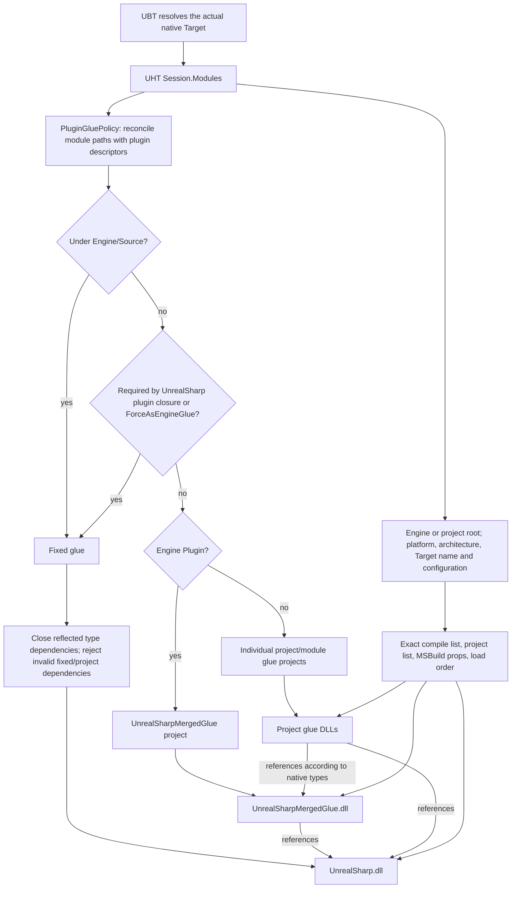
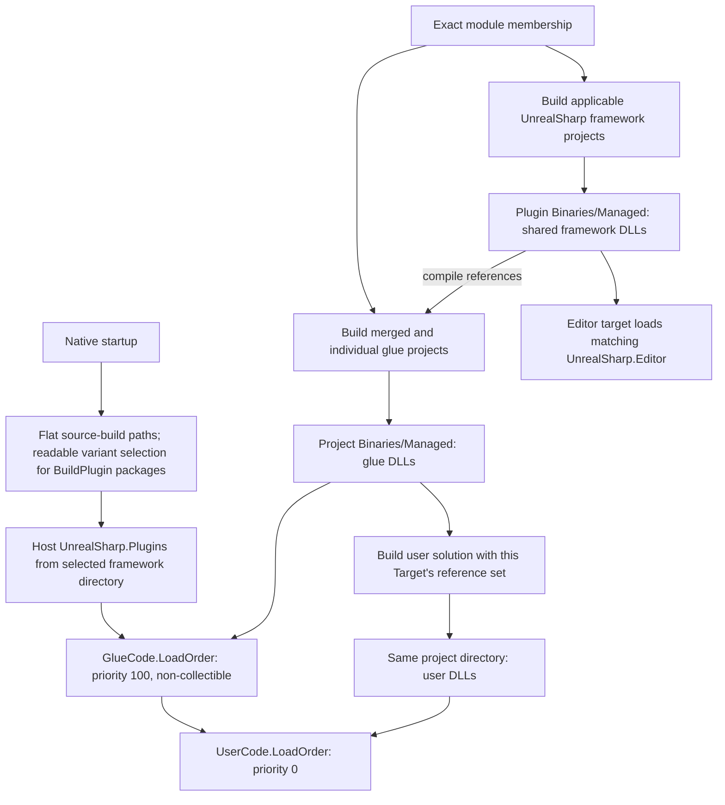

# Separate engine plugin glue

This feature is organized as four review commits on `Edenlia/UnrealSharp` branch `feature/separate-glue-ai-verify`, based on `feature/separate-glue` commit `7475f7e2`. It uses native-style Intermediate paths, flat source-build DLL outputs and readable BuildPlugin variants without hashed Target IDs. The engine integration checkout keeps the feature as uncommitted local changes on `cp-main`.

The build/startup evidence below was collected in the engine integration checkout based on `774e14f528dae0e703df897efbb3730dc672943a`. Only this feature's patches were transferred to the standalone plugin repository. Existing differences between the two repositories, including the standalone branch's UTF-8 binding-length fix, were preserved; the standalone branch was not separately subjected to the full native build/startup matrix.

## Commit sequence

1. Shared glue build context, native-style Intermediate path helper, and reusable reference/build/distribution utilities.
2. Required plugin closure, fixed/merged generation, incremental membership tracking, and integration with user builds and editor workspaces.
3. Native runtime path selection, context forwarding, project packaging and plugin distribution inputs.
4. Regression tests, startup smoke probe and documentation of the final behavior and verification scope.

These commits organize the final implementation for review. Existing build/startup results below apply to the complete implementation; intermediate commits were not independently built or launched.

## Contract

- Engine Source modules, UnrealSharp's own modules and the target-filtered required plugin dependency closure of UnrealSharp belong to UnrealSharp.dll.
- Other Engine Plugin modules in the actual UHT session belong to UnrealSharpMergedGlue.dll. Project plugins/modules retain their generated projects.
- Follow generated type dependencies to keep the fixed assembly independent of optional glue. Diagnose unsupported cycles/extension arrangements rather than creating broken references.
- Persist exact compile/project membership, never discover current target inputs by globbing old target directories.
- Explicit projects and projectless source builds retain flat DLL outputs and ordinary MSBuild obj/bin. Target-generated intermediate files use `Intermediate/Build/<Platform>/<Architecture>/<TargetName>/<Configuration>` directly. BuildPlugin variants use readable package directories; there are no Target IDs.
- UHT-generated projects, automation commands, user compilation, packaging and runtime loading must use the same target context.
- BuildPlugin must retain portable generated fixed glue and managed binaries in its filtered package. No Engine UBT modifications, so the plugin remains usable with a stock installed engine.

## Verification constraints

Native compilation uses only the existing AutoBuild scripts or their exact resolved UBT invocation. Both scripts use Build.bat with Editor Win64 Development and ShaderCompileWorker Win64 Development -Quiet, -WaitMutex -FromMSBuild. Balloon additionally invokes BuildUserSolution. BuildPlugin behavior must be covered by implementation/tests; no ad hoc native BuildPlugin invocation is allowed by workspace policy.

Initial tree: unrelated knowledge documents/catalog and multiple project submodules were already dirty. Preserve them. Initial source HEAD: 774e14f528dae0e703df897efbb3730dc672943a.

## Generation and dependency flow

`PluginGluePolicy` traverses required, enabled `.uplugin` references with target/platform/configuration filters. Optional references do not become mandatory just because the project enabled them. All reflected modules of each required plugin that are present in the UHT session are fixed. Platform extension descriptors retain their parent plugin's ownership and merged dependencies. Engine platform/restricted source extensions also remain fixed. `bBuildAllModules` uses this same actual-session membership; it does not substitute the enabled-plugin list for UHT's module list.

`ModuleUtilities` closes fixed reflected type dependencies before choosing output projects. The framework solutions never reference `UnrealSharpMergedGlue`. Cross-assembly auto-casts retain the library and extension-method APIs but do not emit a partial declaration into the wrong assembly. C# partial declarations cannot cross assembly boundaries.

## Paths and selection

There is no `Id` field. UnrealSharp computes its Intermediate directory from the UHT session's project directory (or Engine directory when there is no project), platform, architecture, native Target name and configuration. This is UnrealSharp's convention for ordinary targets, not a direct read of UBT's `ProjectIntermediateDirectory`: custom intermediate environments, Program targets and platform extension rules may differ. No Engine source change or manifest-location inference is required. Generated files go directly into this directory's existing-purpose subdirectories, without an additional glue root.

The existing `Intermediate/UnrealSharp/UHT/<Type>/UnrealSharp.Target.json` remains a small active-context index for UAT and the Editor. It points at the latest generated native target of that type. Changing its plugin set replaces exact membership rather than accumulating old modules. Editor/Game generation directories coexist; development DLL outputs retain the original active-build model. Packaging recompiles the requested type/configuration into its archive directory without changing the stored source Intermediate directory.

As in the original exporter, ordinary non-Editor UHT generates sources without compiling over the development Editor DLLs. PackageProject publishes the requested framework first, then resolves both framework and glue references from that archive for user compilation. Native glue references remain Copy Local (`Private=true`): switching them off while reusing existing obj caches lets the .NET SDK's incremental publish cleanup delete still-needed DLLs in the shared project output folder.

| Content | Location |
| --- | --- |
| Fixed generated source, ordinary project | `UnrealSharp/Intermediate/UnrealSharp/UHT/<Type>/<Module>` |
| Framework binaries | `UnrealSharp/Binaries/Managed/<TFM>` |
| Optional/project generated source | `<Project>/Intermediate/Build/<Platform>/<Architecture>/<TargetName>/<Configuration>/Modules/<Module>` |
| Merged and project glue projects | Same Target Intermediate directory, under `Projects` |
| Membership manifest and reference props | Directly in the Target Intermediate directory |
| MSBuild obj/bin | Ordinary SDK project paths; no per-Target redirection |
| Glue/user DLLs and load manifests | `<Project>/Binaries/Managed/<TFM>` |

Projectless builds generate under `Engine/Intermediate/Build/<Platform>/<Architecture>/<TargetName>/<Configuration>`; fixed source is in its `Engine` subdirectory. Their framework and merged DLLs both publish to the plugin's flat `Binaries/Managed/<TFM>`. BuildPlugin generates under its temporary HostProject's corresponding Target Intermediate, and publishes variants to `UnrealSharp/Binaries/Managed/BuildPlugin/<Platform>/<Architecture>/<TargetName>/<Configuration>/<TFM>`. The readable distribution directories keep Editor/Game, configurations and platforms from overwriting each other within one package.

UAT and native startup select a BuildPlugin bundle by type/platform/configuration/architecture and reject ambiguity. A consuming project reads the packaged framework but writes its glue/user DLLs to its own flat directory. Old version-1/2 manifests are ignored by automatic selection without deleting old caches; native regeneration is required after upgrading the source layout.

Official builds pass exact source/reference properties. Only BuildPlugin imports the early `UnrealSharp.Target.props` that relocates obj/bin under its HostProject Target Intermediate. The generated IDE pointer supplies exact module references; it does not move ordinary projects' caches. Framework inputs can be shared by compatible project builds, but are not asserted to be invariant across all native Target types. As in the original workflow, builds that write the same framework or C# project outputs must run sequentially.

`ModuleAssemblies` and `Projects` are the exact current membership. `NativeModules` is only a reference-cleanup list, including known/previous native module names so obsolete per-module references do not keep resolving old DLLs. Exporter timestamps and assembly-layout fingerprints are target-scoped. Changing the exporter or changing module assembly ownership invalidates that Target's generation cache.

## BuildPlugin

The foreign `-plugin=<UnrealSharp.uplugin>` invocation marks a distribution context. On successful managed generation, it copies the exact glue output set and its load manifest into the variant's `Glue/<TFM>` directory, and fixed generated `.cs`/`.props` files into its `Source` directory. Generated FilterPlugin rules include only variants produced in that temporary plugin copy. This survives removal of BuildPlugin's HostProject and excludes copied developer caches. After mounting, fixed-source references resolve relative to the installed package's `Source` directory. A precompiled Development variant cannot satisfy a Shipping request.

A consuming project can mount a matching distributed context when it has no native UHT context of its own. It preserves the packaged framework identity, replaces build-machine paths, and deploys glue under the consuming project. Native projects that run UHT get their own exact context. A package cannot supply bindings for native modules that were never in its UHT input; enabling new native modules requires regenerating that native Target.

Staged games retain the existing flat self-contained managed folder and `UnrealSharpBuild.flag`; PackageProject resolves the exact source Target before publishing into it.

## Build and load order

The shared framework assembly cache supplies UnrealSharp.dll to glue and user assemblies. Framework projects do not reference optional glue. The merged assembly is one entry in the existing glue load-order mechanism, so it is loaded before user code without a special DLL-name fallback.

## Review entry points

| Responsibility | Source |
| --- | --- |
| Plugin ownership and required closure | `Source/UnrealSharpManagedGlue/Utilities/PluginGluePolicy.cs` |
| Fixed dependency closure, assembly ownership | `Source/UnrealSharpManagedGlue/Utilities/ModuleUtilities.cs` |
| Exact generated projects and references | `Source/UnrealSharpManagedGlue/ModuleFactory.cs` |
| Build context and distribution relocation | `Managed/Shared/GlueTarget.cs` |
| Framework/glue builds, runtime publication, package filter | `Build/Scripts/Utilities/GlueTargetUtilities.cs` |
| BuildPlugin MSBuild paths | `UnrealSharp.Target.props` |
| Native runtime selection and UAT forwarding | `Source/UnrealSharpUtilities/Private/CSPathsUtilities.cpp`, `CSBuildUtilties.cpp` |
| Validation | `Tests/GlueTargets` |

## Direct Intermediate layout verification (2026-10-14)

- The standalone Exporter and Automation projects compile against this checkout's UE assemblies with zero warnings/errors.
- `dotnet run --project Tests/GlueTargets/GlueTargets.csproj` passes: direct Target Intermediate directories, shared framework and flat project/projectless DLL outputs, Editor/Game source separation, stable source location when changing managed configuration, obsolete-manifest rejection, universal architectures, distribution selection and relocation.
- `dotnet run --project Tests/GlueTargets/GlueTargets.csproj -- --distribution <PluginRoot> <EngineDirectory>` passes against the freshly compiled Automation helper and UE's actual FileFilter. It verifies Editor/Development, Game/Development and Game/Shipping variants, portable fixed `.cs`/`.props` files, relocation, bundle deployment, ordinary MSBuild arguments and exclusion of copied caches. The test accepts either a standalone `bin/Development` build or a UAT `uatbin/Development` build of the helper.
- Balloon's canonical native build passed (exit 0), including UHT generation into `Intermediate/Build/Win64/x64/BalloonEditor/Development`, managed framework/glue publication, and compilation/linking of `CSPathsUtilities.cpp`. The official BuildUserSolution also passed (exit 0). Generated-code and gameplay warnings remain. Logs: `Balloon/Saved/SeparateGlue-DirectIntermediate-Native-01.log` and `SeparateGlue-DirectIntermediate-Managed-01.log`.
- PE inspection of Balloon's newly published DLLs passes: fixed/optional membership, no framework references to optional glue, exact glue load order and no duplicated public types between fixed and optional assemblies.
- Balloon's no-window Python commandlet startup passes (exit 0), finding all 40 expected managed assemblies, including UnrealSharp.Editor and UnrealSharpMergedGlue. No UnrealSharp warnings/errors were logged; unrelated engine/project warnings remain. Log: `Balloon/Saved/SeparateGlue-DirectIntermediate-Smoke-01.log`. This does not exercise PIE, rendering or game packaging.
- BuildPlugin native compilation, projectless `bBuildAllModules`, other platforms and non-Editor packaging are not covered by these checks. The canonical project AutoBuild entry points available here only cover Win64 Editor/Development; no ad hoc BuildPlugin/UHT command is used.
